 

 

## 👋 About Me

I am a **Junior Information Systems Analyst** passionate about **Computer Vision** and **Image Analytics**, with hands on experience building Vision AI and machine learning solutions that turn images and video into meaningful, reliable insights.

My background combines a degree in **Systems Analysis and Development** with an ongoing **postgraduate program in Machine Learning and Big Data** at Universidade Estadual de Londrina (UEL), which allows me to bridge solid software engineering with applied artificial intelligence.

- 👁️ **Passionate about** computer vision, image analytics and how machines learn to understand the visual world
- 🧠 **Experienced with** object detection, image segmentation, anomaly detection and video analytics
- 🎓 **Studying** Machine Learning and Big Data at UEL
- ⚙️ **Building with** Python, PyTorch, OpenCV, FastAPI and React
- 🤝 **Open to** collaborating on AI, computer vision and data driven projects

 

## 🎯 What I Do

<table>
  <tr>
    <td width="33%" valign="top">
      <h3 align="center">👁️ Computer Vision</h3>
      
Object detection, image segmentation and visual anomaly detection applied to real world images and video streams.

    </td>
    <td width="33%" valign="top">
      <h3 align="center">🧠 Machine Learning</h3>
      
Model research, benchmarking and validation, from dataset preparation to measurable, reproducible results.

    </td>
    <td width="33%" valign="top">
      <h3 align="center">🛠️ Software Engineering</h3>
      
Full stack applications that put models in the hands of users, with clean APIs, responsive interfaces and automated reporting.

    </td>
  </tr>
</table>

 

## 🧰 Tech Stack

<table>
  <tr>
    <td align="center" width="140"><b>Languages</b></td>
    <td></td>
  </tr>
  <tr>
    <td align="center"><b>AI and Data</b></td>
    <td>
      
       
      
      
      
      
      
    </td>
  </tr>
  <tr>
    <td align="center"><b>Backend</b></td>
    <td></td>
  </tr>
  <tr>
    <td align="center"><b>Frontend</b></td>
    <td></td>
  </tr>
  <tr>
    <td align="center"><b>Databases</b></td>
    <td></td>
  </tr>
  <tr>
    <td align="center"><b>Tools and Cloud</b></td>
    <td></td>
  </tr>
</table>

 

## 🎓 Education

| Program | Institution | Status |
| :--- | :--- | :--- |
| 🧠 Postgraduate in Machine Learning and Big Data | Universidade Estadual de Londrina (UEL) | In progress |
| 💻 Systems Analysis and Development | Universidade Positivo | Completed in 2024 |

 

## 📈 GitHub Stats

 

## 🤝 Let's Connect

I am always open to discussing computer vision, machine learning and new opportunities to build impactful solutions.

 

 
 

<i>"Technology is best when it brings people together."</i>
 
Matt Mullenweg

 
 

